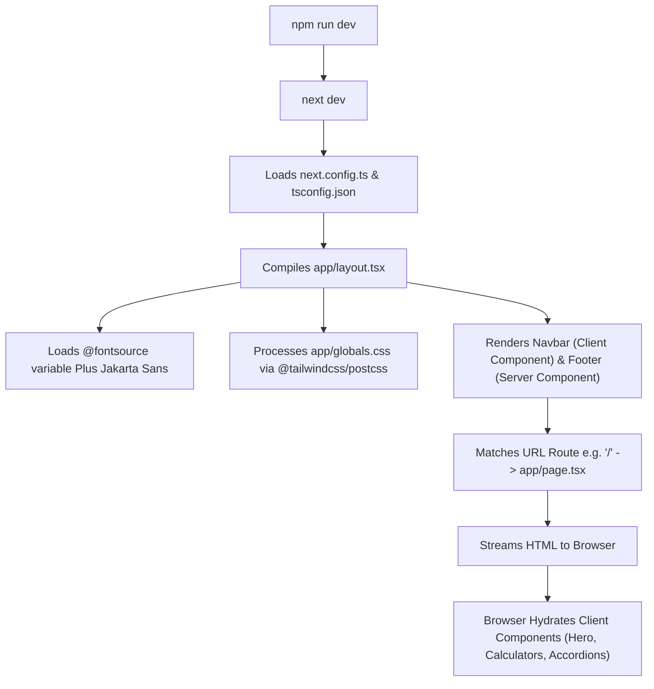

# HM Wealth — Application Flow & Execution Lifecycle

## 1. Startup Lifecycle (Development)
When executing `npm run dev`:

## 2. Page Resolution & Rendering Flow
1. **Root Layout (`app/layout.tsx`)**:
   - Executes as a Server Component.
   - Sets HTML language to `en-IN` and theme color meta tag to `#0b7a55`.
   - Injects the accessibility skip-link (`#main`).
   - Renders `<Navbar />` (Client Component for scroll detection and mobile menu state).
   - Wraps child page in `<main id="main">{children}</main>`.
   - Renders `<Footer />` (Server Component, with `<FooterWordmark />` as an animated client child).

2. **Route Resolution**:
   - `/` -> `app/page.tsx`
   - `/investments` -> `app/investments/page.tsx`
   - `/insurance` -> `app/insurance/page.tsx`
   - `/calculators` -> `app/calculators/page.tsx` (wraps `<CalculatorSuite />` inside `<Suspense>`)
   - `/about` -> `app/about/page.tsx`
   - `/contact` -> `app/contact/page.tsx`
   - Any unknown path -> `app/not-found.tsx`

3. **Fast Refresh / HMR**:
   - Editing any `.tsx` or `.ts` file triggers Next.js React Fast Refresh, updating components in place while preserving React state.
   - Editing `app/globals.css` instantly updates Tailwind styles via PostCSS.

## 3. Production Build Pipeline
When executing `npm run build`:
1. Next.js triggers `next build`.
2. TypeScript runs type checking against `tsconfig.json`.
3. Next.js statically analyzes routes:
   - All 6 routes (`/`, `/investments`, `/insurance`, `/calculators`, `/about`, `/contact`) are statically pre-rendered at build time.
   - `<CalculatorSuite />` is wrapped in `<Suspense>` because it accesses query parameters via `useSearchParams()`.
4. Output is generated into the `.next` directory for optimal high-speed CDN hosting or Node.js deployment (`next start`).

