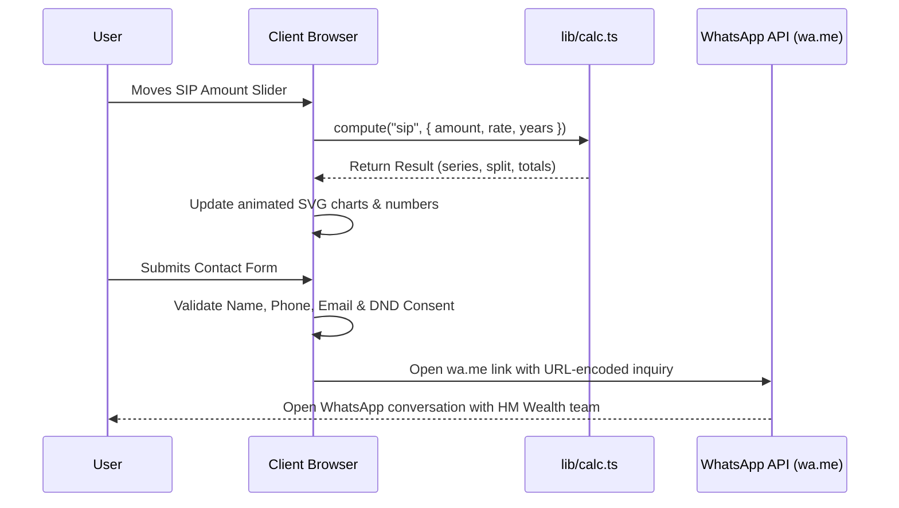

# HM Wealth — Interactions & Data Flow

## 1. Data Flow Architecture
The website operates as a **high-speed static site with zero backend database dependencies**:
- **No external API keys or server secrets are required.**
- All content and disclosures originate from `lib/site.ts`.
- All financial calculations are executed purely in client memory (`lib/calc.ts`).
- Leads and customer inquiries are dispatched via direct client-side WhatsApp integration (`window.open`).



## 2. Interactive Feature Catalog

### A. Dynamic Hero Story Carousel (`components/home/Hero.tsx`)
- **Trigger:** 6500ms automatic interval or manual clicking of the 4 goal tabs.
- **State:** `index` (0-3), `paused` (boolean).
- **Behavior:** Cross-fades background photograph, smoothly spins the headline goal text ("Invest today for [your child's future]"), updates the floating glass goal card, and fills the tab's progress bar.
- **Mouse Parallax:** Tracking cursor coordinates creates an opposite-direction floating depth effect on the 3D coin and goal card.

### B. Financial Calculator Suite (`components/calculators/CalculatorSuite.tsx`)
- **Tabs:** SIP, Lumpsum, Step-up SIP, SWP, Loan EMI, Goal SIP.
- **Deep Linking:** Synchronizes active tab with browser URL query parameter `?c=sip`, `?c=stepup`, etc., via Next.js `useSearchParams()` and `router.replace(..., { scroll: false })`.
- **Dynamic Calculation:** Every slider change recalculates results instantly without lag.
- **Visual Feedback:** Numbers count up using Framer Motion springs (`useMotionValue`), donut charts animate segment lengths, and the SVG area chart re-renders smoothly.

### C. Riskometer Dial (`components/investments/Riskometer.tsx`)
- **Trigger:** Clicking any of the 6 color-coded buttons or directly clicking an arc on the SVG dial.
- **State:** `level` (0 to 5).
- **Behavior:** The needle springs to the target angle (`tip` coordinate calculation) with physics parameters `stiffness: 90, damping: 14`. The explanation card below announces the risk level to screen readers (`aria-live="polite"`).

### D. FAQ Accordions (`components/sections/Faq.tsx`)
- **Trigger:** Clicking a question row.
- **State:** `open` (index or `null`). Only one accordion item opens at a time.
- **Behavior:** Expands answer smoothly with spring motion, rotates the `+` icon to an `x` (45 degrees), and shifts background pill shadow.

### E. Callback Lead Form (`components/contact/ContactForm.tsx`)
- **Validation:**
  - Name: Must be non-empty.
  - Mobile: Strict Indian mobile regex `^(\+?91)?[6-9]\d{9}$`.
  - Email: Optional, but if provided must match standard email pattern.
  - DND Consent Checkbox: Mandatory consent to contact.
- **Submission:**
  - Assembles a structured message:
    ```
    Hello HM Wealth, I would like a call back.
    Name: [Name]
    Mobile: [Phone]
    Email: [Email]
    City: [City]
    Interested in: [Topic]
    Message: [Message]
    ```
  - Dispatches via `window.open("https://wa.me/919618101040?text=...")`.
  - Transitions UI into a success confirmation card with instructions.

